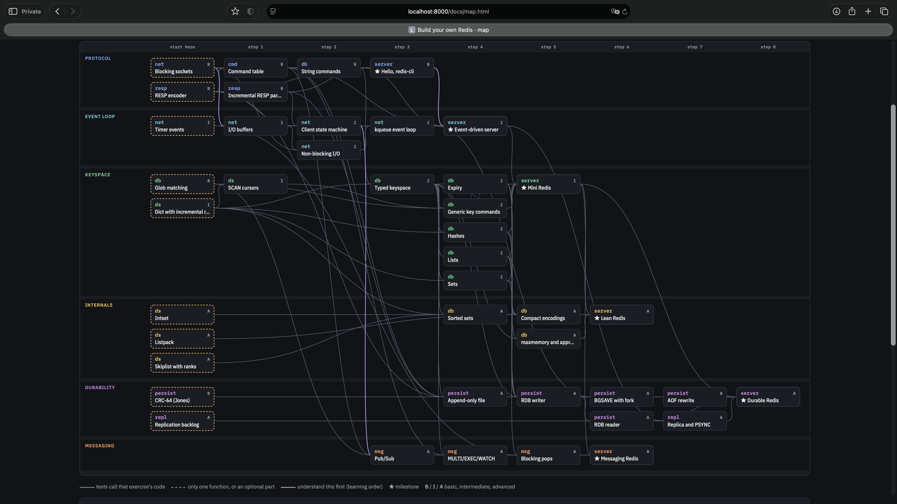

# coursekit: a template for learning by building

A repo template for a self-paced, hands-on course on **any topic you can
write code for**: compilers, databases, numerical methods, networking,
machine learning, data structures. Together with a coding agent (Claude Code,
Codex, Cursor, ...) you turn it into a course built around *your* goals:

- **small exercises that build on each other**: each one is a README with one
  idea, an API to implement, stubs marked `TODO(you)`, and tests that fail
  until you're done;
- **milestones built from your own code**: every track ends in something
  real, assembled from the pieces you wrote;
- **tests checked against an outside oracle**, and a **hidden reference
  solution** (on a separate branch) that proves every exercise is passable;
- **an interactive map** of the course: what each exercise needs, what you
  can start now, what you've finished;
- **a progress report** from your actual test results.

The agent designs the course with you, writes the exercises, keeps the tests
honest, and gives hints when you're stuck. You write the solutions.

## Example: build your own Redis

A course made from this template: learn how Redis works by building one in
C++20. The RESP protocol, a single-threaded event loop, the keyspace and its
data structures, expiry, eviction, persistence, replication and messaging,
across six tracks. Each track ends in a ★ milestone: a server that
`redis-cli` and `redis-benchmark` talk to unchanged, checked against replies
recorded from real Redis.

- **[Open the interactive map](https://lowlevelbits.org/coursekit/redis/)**:
  click an exercise to see what it needs.
- **[Browse the course](https://github.com/AlexDenisov/coursekit/tree/redis)**
  on the `redis` branch: its README, `curriculum.json`, and the exercises.
- **[Reference solutions](https://github.com/AlexDenisov/coursekit/tree/redis-solutions)**
  on the `redis-solutions` branch (spoilers): what `verify.sh` checks every
  exercise against.

[](https://lowlevelbits.org/coursekit/redis/)

## What's in the template

| File | What it is |
|---|---|
| [AGENTS.md](AGENTS.md) | What the agent does: bootstrap interview, rules, how to add exercises. `CLAUDE.md` points to it |
| [PLAYBOOK.md](PLAYBOOK.md) | The design: principles, repo layout, exercise anatomy, tests, the map, progress, stack recommendations |
| [curriculum.json](curriculum.json) | The course as data: levels, tracks, exercises, dependencies. Placeholder content until you bootstrap |
| [docs/map.html](docs/map.html) | The interactive map; open it in a browser |
| [docs/project.md](docs/project.md) | Your course's own choices, filled in during bootstrap |
| `tools/sync_curriculum.py` | Validates `curriculum.json`; regenerates `docs/curriculum.js`, `roadmap.md`, `dependencies.md` |
| `tools/progress.py` | Runs your tests, prints where you are, updates the map |
| `tools/runners/` | How tests are run: `command` (any stack), `bazel`, or your own (a small JSON protocol) |
| `starters/cpp-bazel/` | A ready C++20 + Bazel + GoogleTest + hermetic clang setup, with a sample exercise |
| `starters/python-uv/` | Python + uv + pytest + ruff, with the same sample exercise |
| `starters/rust-cargo/` | Rust cargo workspace (one crate per exercise), with the same sample exercise |
| `starters/solutions/` | The `solutions` branch skeleton: `verify.sh` and its README |
| `tests/`, `.github/workflows/ci.yml` | End-to-end checks of every starter (with the samples' reference solutions), run in CI on Linux and macOS |
| [LICENSE](LICENSE), [CONTRIBUTING.md](CONTRIBUTING.md) | MIT; how to improve the template itself |

Requirements: `git`, `python3` (3.9+, standard library only), a browser, and
whatever toolchain your course uses: `bazelisk` for C++ (the compiler is
downloaded by Bazel), `uv` for Python, `rustup` for Rust.

## Start your own course

1. **Make a copy.** Use this repo as a template on GitHub, or:
   ```sh
   git clone <this repo> my-course && cd my-course
   rm -rf .git && git init
   ```
2. **Open your agent in the repo** and ask it to bootstrap. For example:
   > Read AGENTS.md and bootstrap a course. I want to learn how relational
   > databases work by building a small one in Rust. I know SQL well, and
   > some Rust.

   It reads [AGENTS.md](AGENTS.md) and [PLAYBOOK.md](PLAYBOOK.md), then
   interviews you: your goal, background, language, setup. Answer honestly;
   the course is shaped around the answers.
3. **Agree on the plan.** The agent proposes tracks (goals), milestones,
   levels and a first slice of exercises. Push back until it's the course
   you want.
4. **Let it scaffold.** It fills in `docs/project.md` and `curriculum.json`,
   sets up the toolchain (for C++, from `starters/cpp-bazel/`), writes the
   course README and the first few exercises, and creates the hidden
   reference solutions in a worktree next to the repo:
   ```
   <workspace>/
     my-course/              main: exercises + your work
     my-course-solutions/    solutions (spoilers), committed by the agent
   ```
5. **Review and commit.** The agent never commits on `main` and never
   pushes; you review its changes and commit them yourself.

## The learning loop

```sh
open docs/map.html                 # pick an exercise (or: xdg-open / start)
$EDITOR <domain>/<exercise>/       # read README.md, fill in the TODO(you) stubs
<test command from the README>     # until the tests pass
python3 tools/progress.py          # where am I? (and updates the map)
git commit -am "<exercise>: done"
```

Ask the agent when you need it:

- "I'm stuck on `<exercise>`": you get the weakest hint that unblocks you,
  not the solution (unless you ask for it);
- "review my `<exercise>`": correctness, the cases the tests miss,
  complexity;
- "write the next exercises" / "add a track on X": the course grows ahead of
  you;
- "where am I?": a summary of the progress report and what to do next.

## Editing the course by hand

Everything about the course structure is in `curriculum.json`. After editing
it:

```sh
python3 tools/sync_curriculum.py
```

It checks ids, levels, tracks, edges, cycles and the level rule (an exercise
depends only on exercises at its level or below), then regenerates the map
data and the docs. How tests are run for the progress report is set in its
`progress` block; see [PLAYBOOK.md §8](PLAYBOOK.md#8-progress-toolsprogresspy).

## Choosing a language

Anything with a test runner works; PLAYBOOK §11 lists the requirements.
There are ready starters for Python (`uv`, `pytest`) and Rust (`cargo`). For C++ the recommended stack
(PLAYBOOK §12, ready in `starters/cpp-bazel/`) is modern C++20, Bazel with
bzlmod, GoogleTest, and a hermetic clang from
[mull-project/toolchains](https://github.com/mull-project/toolchains), so the
course builds with the same compiler everywhere.

## Contributing and license

Improvements to the template (tooling, the map, starters, runners, the
playbook) are welcome; see [CONTRIBUTING.md](CONTRIBUTING.md). The template is
under the [MIT license](LICENSE). A course made from it keeps that `LICENSE`
file, because MIT requires the notice to stay with the template code the course
still contains. What you add yourself (exercises, solutions, notes) you may
license however you like, in a separate file next to it.
The hedron patch in `starters/cpp-bazel/third_party/` is Apache-2.0.
