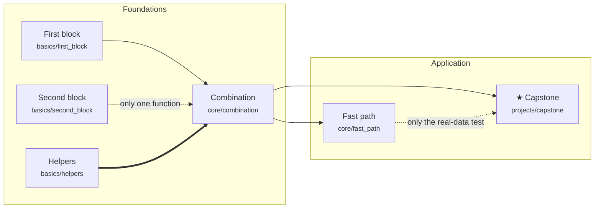

# Dependencies

Generated by `tools/sync_curriculum.py` from `curriculum.json`; don't edit.

Edge kinds: `req` (solid: the tests call that code), `part` (dashed: one function
or an optional part), `real` (dashed: only a real-data test or bench needs it),
`learn` (thick: understand it first, no shared code), `idea` (background; listed below, not drawn).

## Helpful background (not drawn)

| For | Read first | Why |
|---|---|---|
| `projects/capstone` | `basics/second_block` | helpful background |
